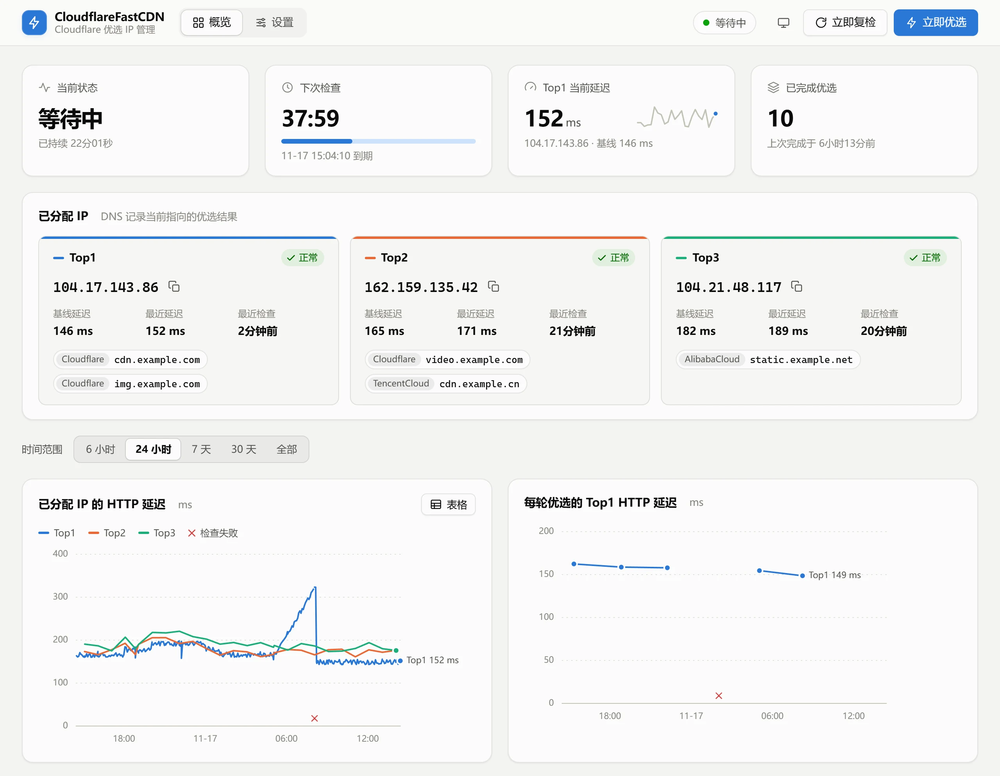
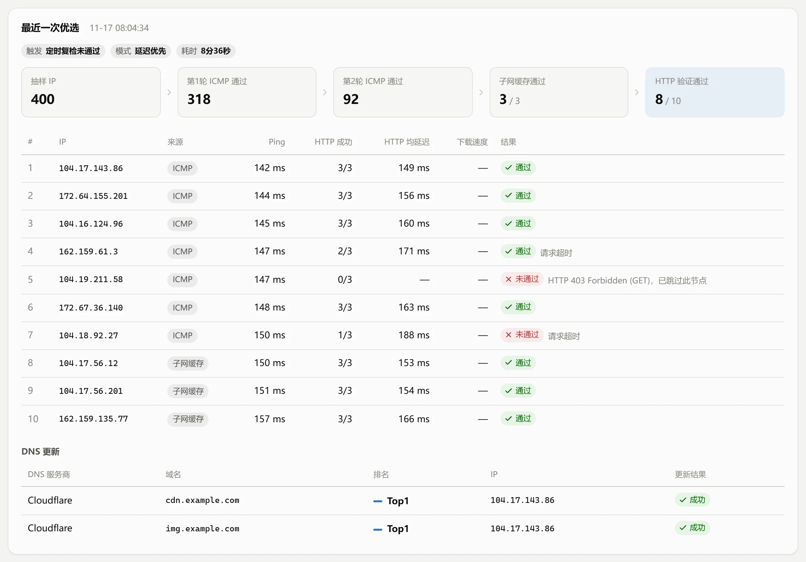
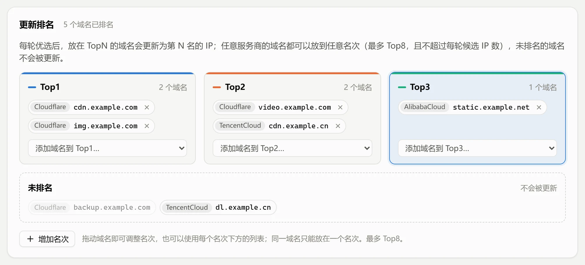
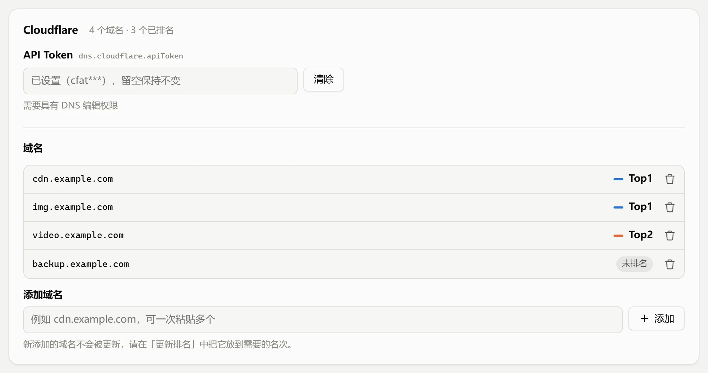
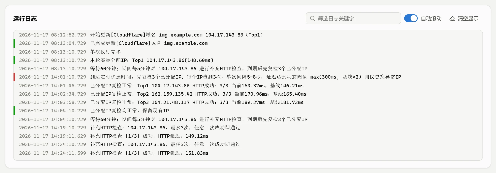
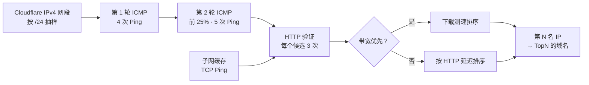
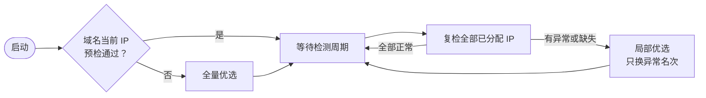

<div align="center">


# CloudflareFastCDN

**自动优选 Cloudflare CDN IP，并把最快的节点写入你的 DNS 解析**

支持 Cloudflare · 腾讯云 DNSPod · 阿里云解析 · 自带 Web 管理面板

[](https://github.com/aiqinxuancai/CloudflareFastCDN/releases)
[](https://github.com/aiqinxuancai/CloudflareFastCDN/actions/workflows/docker-image.yml)
[](https://github.com/aiqinxuancai/CloudflareFastCDN/pkgs/container/cloudflarefastcdn)
[](https://dotnet.microsoft.com/)

[快速开始](#快速开始) · [界面预览](#界面预览) · [域名与更新排名](#域名与更新排名) · [工作原理](#工作原理) · [配置](#配置) · [常见问题](#常见问题)

</div>

<br>

<picture>
  <source media="(prefers-color-scheme: dark)" srcset="docs/images/dashboard-dark.webp">
  
</picture>

<p align="center"><sub>管理面板概览（截图使用演示数据，面板会跟随系统切换浅色 / 深色主题）</sub></p>

> 推荐阅读：[试试Cloudflare IP优选！让Cloudflare在国内再也不是减速器！](https://2x.nz/posts/cf-fastip/)

## 功能

- **多轮筛选**：按 `/24` 子网抽样 Cloudflare IPv4 网段，经两轮 ICMP Ping、子网缓存 TCP Ping 和 HTTP 验证选出最快的节点，可选按下载带宽排序
- **任意域名、任意名次**：域名按 DNS 服务商管理，在「更新排名」中拖动即可把任意域名放到 Top1 ~ Top8 的任意名次
- **只换坏掉的那个**：定期复检全部已分配 IP，只为延迟异常或失联的名次重新优选，正常的 IP 和基线保持不动
- **三家 DNS 服务商**：Cloudflare、腾讯云 DNSPod、阿里云解析可以同时使用，自动创建或更新 A 记录
- **Web 管理面板**：实时状态、延迟趋势图、每轮优选的完整过程、运行日志，以及全部设置项；支持浅色 / 深色主题和登录密码
- **一个配置文件**：全部设置保存在 `settings.json`，页面修改即时写回；旧版的环境变量配置会在首次启动时自动迁移
- **开箱即用**：提供 Docker 镜像与 Windows / Linux 原生 AOT 可执行文件

## 界面预览

<table>
  <tr>
    <td colspan="2">
      <picture><source media="(prefers-color-scheme: dark)" srcset="docs/images/selection-detail-dark.webp"></picture>
      <p align="center"><b>优选详情</b><br><sub>每个阶段的通过数量、候选 IP 的验证结果与 DNS 更新</sub></p>
    </td>
  </tr>
  <tr>
    <td width="50%" valign="top">
      <picture><source media="(prefers-color-scheme: dark)" srcset="docs/images/settings-ranking-dark.webp"></picture>
      <p align="center"><b>更新排名</b><br><sub>跨服务商拖动域名到任意 TopN，未排名的域名不会被更新</sub></p>
    </td>
    <td width="50%" valign="top">
      <picture><source media="(prefers-color-scheme: dark)" srcset="docs/images/settings-provider-dark.webp"></picture>
      <p align="center"><b>服务商与域名</b><br><sub>每家服务商单独填写凭证、添加域名，密钥只写不读</sub></p>
    </td>
  </tr>
  <tr>
    <td colspan="2">
      <picture><source media="(prefers-color-scheme: dark)" srcset="docs/images/logs-dark.webp"></picture>
      <p align="center"><b>运行日志</b><br><sub>实时滚动，支持关键字筛选，按成功、警告、失败分色标记</sub></p>
    </td>
  </tr>
</table>

## 快速开始

### Docker Compose（推荐）

```bash
cp .env.example .env
docker compose up -d
```

打开 `http://<主机IP>:19401/`，首次启动会自动进入「设置」页面：

1. 在 **Cloudflare / 腾讯云 DNSPod / 阿里云解析** 中填写凭证并添加域名
2. 在 **更新排名** 中把域名拖到需要的名次（Top1 使用最快的 IP）
3. 点击 **保存设置**，程序随即开始优选

> [!IMPORTANT]
> 请同时在「设置 → Web 管理」中设置登录密码。未设置密码时，任何能访问该端口的人都可以查看和修改设置。

默认拉取 `ghcr.io/aiqinxuancai/cloudflarefastcdn:latest`，可在 `.env` 中修改 `IMAGE_TAG` 固定版本；如果 GHCR 软件包为私有，请先执行 `docker login ghcr.io`。

<details>
<summary><b>使用 docker run</b></summary>

```bash
docker run -d \
  --name cloudflare-fast-cdn \
  --restart unless-stopped \
  --cap-add NET_RAW \
  -e TZ=Asia/Shanghai \
  -p 19401:19401 \
  -v cloudflare-fast-cdn-data:/data \
  ghcr.io/aiqinxuancai/cloudflarefastcdn:latest
```

`NET_RAW` 用于 ICMP Ping；配置、历史和缓存都保存在 `/data` 数据卷中。

</details>

<details>
<summary><b>直接运行可执行文件</b></summary>

从 [Releases](https://github.com/aiqinxuancai/CloudflareFastCDN/releases) 下载 `CloudflareFastCDN-win-x64.zip` 或 `CloudflareFastCDN-linux-x64.zip`，解压后运行：

```bash
./CloudflareFastCDN
```

首次运行会在当前目录生成 `settings.json`。管理页面默认只监听 `127.0.0.1`，需要从其他设备访问时，把配置文件中的 `web.host` 改为 `0.0.0.0` 后重启。

</details>

> [!TIP]
> 需要更换访问端口时，只修改端口映射冒号左侧的宿主机端口即可（例如 `-p 8080:19401`），无需改动容器内的监听端口。

## 域名与更新排名

域名属于各自的 DNS 服务商：在服务商的设置中单独添加，添加时不需要指定排名。

排名在「更新排名」中统一调整：把域名拖到 Top1 ~ Top8 的任意名次（也可以用每个名次下方的列表），任意服务商的域名都可以放到任意名次，同一名次可以放多个域名。每轮优选后，**TopN 中的域名会被更新为第 N 名的 IP**；未排名的域名保留在配置中，但不会被更新。

- 只有存在已排名域名的服务商才需要填写凭证
- 可用的最高名次不超过「每轮候选 IP 数」，否则高名次永远分配不到 IP，保存时会被拒绝
- 修改已排名的域名、名次或对应服务商的凭证会自动安排一次全量优选；只添加未排名的域名不会触发优选

## 工作原理

**一轮优选**从数百个抽样 IP 中逐级筛选，最后按名次写入 DNS：



**运行周期**中只更换出问题的名次，尽量少改动 DNS：



<details>
<summary><b>筛选与复检的细节</b></summary>

- **首次启动预检**：解析所有已排名域名的 A 记录，对去重后的每个 IPv4 地址做一次 HTTP 检查，并以检查延迟作为后续复检的初始基线。任一域名解析失败、没有 IPv4 地址或检查失败时立即全量优选；全部正常时不改写 DNS，直接进入等待周期。启用 `schedule.forceInitialFullSelection` 可让首次启动必定全量优选。
- **第二轮 ICMP**：选取本轮实际抽样数量的前 25%（向上取整），例如抽样 400 个时取 100 个。
- **最终候选**：共 `selection.httpCandidateCount` 个，其中 `selection.cachedCandidateCount` 个名额留给子网缓存（从延迟最低的缓存子网中各随机取一个 IP，通过 TCP Ping 即入选），其余取第二轮 ICMP 的靠前结果；缓存通过的 IP 不足时由 ICMP 结果补足。
- **HTTP 验证**：浏览器导航风格的 `GET` 请求，优先 HTTP/2，只读取响应头；收到 `HTTP 403 Forbidden (GET)` 或超时会立即跳过当前节点。
- **复检**：等待结束后按最终验证的节奏复检全部已分配 IP，不会在第一个异常处停止。延迟失效阈值为 `max(300ms, 当前基线 × 2)`，HTTP 失败、错误码或超时同样视为异常；复检通过且延迟低于基线时会下调基线。
- **局部优选**：只为异常 IP 对应的域名重新优选并更新 DNS，排除当前已分配的 IP；新 IP 不足或 DNS 更新失败时保留原分配，下个周期继续。通过验证的 IP 少于最高名次时，缺少的名次同样在下个周期补齐。
- **补充检查**：启用 `schedule.supplementalHttpCheck` 后，等待期间每 5 分钟检查一次 Top1，连续 3 次失败提前优选。
- **IP 网段列表**：优先读取数据目录中的 `ip.txt`（「启动时更新 IP 段」下载的列表，也可以放入自定义列表），不存在时使用随程序发布的列表。

手动「立即优选」、DNS 配置变更以及强制首次全量优选始终执行全量优选。

</details>

## 配置

全部设置保存在一个本地配置文件中，可以在 Web 页面修改，也可以直接编辑后重启程序（支持 `//` 注释和尾逗号）：

| 运行方式 | 配置文件 | 其他数据文件 |
| --- | --- | --- |
| Docker | `/data/settings.json` | 同在 `/data` 数据卷 |
| 直接运行 | 当前目录下的 `settings.json` | 同在当前目录 |

读取时会逐项校验，格式错误或超出范围的值会在日志中提示并使用默认值；整个文件不是有效 JSON 时会备份为 `settings.json.invalid` 并重新生成。文件包含 DNS 凭证和登录密码，在 Linux 上以 `600` 权限保存。

> [!NOTE]
> **从旧版本升级**：旧版通过环境变量（`.env`）、命令行参数（`--KEY=VALUE`）或只有 `values` 字典的旧版 `settings.json` 配置。升级后首次启动时会把它们**一次性迁移**到新配置文件，优先级与旧版一致：环境变量 > 命令行参数 > 旧版 settings.json。旧版的 `*_DOMAINS` / `*_DOMAINS2` / `*_DOMAINS3` 会变成对应服务商下排名 Top1 / Top2 / Top3 的域名，旧版文件备份为 `settings.json.v1.bak`。迁移后环境变量不再生效，启动日志会列出残留的旧变量名，确认无误后即可删除。

<details>
<summary><b>配置文件示例</b></summary>

```jsonc
{
  "version": 2,
  "dns": {
    "cloudflare": {
      "apiToken": "your-api-token",
      "domains": [
        { "name": "cdn.example.com", "rank": 1 },
        { "name": "cdn2.example.com", "rank": 2 },
        { "name": "backup.example.com" }   // 未排名，不会被更新
      ]
    },
    "tencentCloud": { "secretId": "", "secretKey": "", "domains": [] },
    "alibabaCloud": { "accessKeyId": "", "accessKeySecret": "", "domains": [] }
  },
  "selection": {
    "maxIps": 400,
    "httpCandidateCount": 10,
    "cachedCandidateCount": 3,
    "pingThreads": 8,
    "pingIntervalMs": 150,
    "bandwidthPriority": false,
    "updateIpList": false
  },
  "http": {
    "probeUrl": "https://www.visa.cn/",
    "probeHeaders": { "X-CDN-Probe-Token": "your_random_token" },
    "probeTimeoutMs": 4000,
    "speedTestTimeoutMs": 10000,
    "speedTestIdleTimeoutMs": 3000
  },
  "schedule": { "runMinutes": 60, "supplementalHttpCheck": false, "forceInitialFullSelection": false },
  "web": { "port": 19401, "host": "", "username": "admin", "password": "" }
}
```

</details>

<details>
<summary><b>全部配置项</b></summary>

| 配置项 | 默认值 | 说明 |
| --- | --- | --- |
| `dns.cloudflare.apiToken` | 空 | Cloudflare API Token（需 DNS 编辑权限） |
| `dns.tencentCloud.secretId` / `secretKey` | 空 | 腾讯云 API 凭证 |
| `dns.alibabaCloud.accessKeyId` / `accessKeySecret` | 空 | 阿里云 API 凭证 |
| `dns.*.domains` | 空 | 该服务商的域名列表；`rank` 为 1 ~ 8 表示使用第几名的 IP 更新，省略表示未排名 |
| `selection.maxIps` | `400` | 每轮最多抽样 IP 数 |
| `selection.httpCandidateCount` | `10` | 每轮进入最终 HTTP 验证的 IP 数（1 ~ 30，含子网缓存），不能小于已使用的最高名次；每个候选约需 1 分钟验证 |
| `selection.cachedCandidateCount` | `3` | 每轮从子网缓存中取出验证的 IP 数（0 ~ 10），不能大于 `httpCandidateCount`，`0` 表示不从缓存取 IP |
| `selection.pingThreads` | `8` | Ping 并发线程数 |
| `selection.pingIntervalMs` | `150` | 单次 Ping 间隔（毫秒） |
| `selection.bandwidthPriority` | `false` | 启用带宽优选（下载 `/speedtest` 测速），失败自动回退延迟优选 |
| `selection.updateIpList` | `false` | 启动时更新 Cloudflare 官方 IPv4 网段列表并保存到数据目录（重启后生效） |
| `http.probeUrl` | `https://www.visa.cn/` | HTTP 验证地址，建议使用已开启 Cloudflare 代理（黄云）的自有站点 |
| `http.probeHeaders` | 空 | HTTP 验证和测速请求附加的请求头，页面中每行一个 `Header-Name: Value` |
| `http.probeTimeoutMs` | `4000` | HTTP 验证超时（毫秒） |
| `http.speedTestTimeoutMs` | `10000` | 测速总超时（毫秒） |
| `http.speedTestIdleTimeoutMs` | `3000` | 测速读取空闲超时（毫秒） |
| `schedule.runMinutes` | `60` | 每轮完成后等待的分钟数 |
| `schedule.supplementalHttpCheck` | `false` | 等待期间每 5 分钟补充验证 Top1，连续 3 次失败提前优选 |
| `schedule.forceInitialFullSelection` | `false` | 跳过首次域名 IP 预检，直接全量优选（重启后生效） |
| `web.port` | `19401` | 管理页面端口，`0` 表示关闭（之后只能编辑配置文件，缺少有效 DNS 配置时程序直接退出）；重启后生效 |
| `web.host` | 空（自动） | 监听地址，留空时 Docker 下为 `0.0.0.0`、直接运行时为 `127.0.0.1`；重启后生效 |
| `web.username` | `admin` | 登录用户名 |
| `web.password` | 空 | 登录密码，留空则无需登录 |

容器时区仍通过 Docker 环境变量 `TZ` 设置（例如 `Asia/Shanghai`），决定日志时间。日志时间戳格式为 `yyyy-MM-dd HH:mm:ss.fff zzz`。

</details>

<details>
<summary><b>为探测请求放行 Cloudflare 规则</b></summary>

`http.probeHeaders` 可配合 Cloudflare 自定义规则，只放行带有指定请求头的探测请求：

```txt
(http.request.uri.path eq "/cf-health.txt"
 and any(http.request.headers["x-cdn-probe-token"][*] eq "your_random_token"))
```

</details>

<details>
<summary><b>带宽测速</b></summary>

启用 `selection.bandwidthPriority` 后，程序会访问 `http.probeUrl` 同域下的 `/speedtest` 文件测速，建议准备一个 **≥ 4 MB** 的静态文件；测速失败时自动回退为延迟优选。

</details>

## 常见问题

<details>
<summary><b>忘记了登录密码怎么办？</b></summary>

编辑配置文件，把 `web.password` 改为 `""` 后重启，即可免密登录并在页面中重新设置。

</details>

<details>
<summary><b>为什么某个名次显示「未分配」？</b></summary>

上一轮通过验证的 IP 数量少于该名次，或该名次的 DNS 更新失败。程序会在下一个周期单独为它补齐，不影响其他名次；也可以在「优选参数」中调大每轮候选 IP 数。

</details>

<details>
<summary><b>只想维护部分域名，其余暂时不更新？</b></summary>

在「更新排名」中把它们移到「未排名」即可，域名仍保留在服务商的列表中，随时可以重新排名。

</details>

<details>
<summary><b>关闭了 Web 管理页面后如何修改设置？</b></summary>

直接编辑配置文件后重启程序。`web.port` 改回非 `0` 的端口即可重新启用管理页面。

</details>

## 免责声明

请仅在你拥有合法管理权限的账号和域名下使用，由此产生的任何后果由使用者自行承担。
